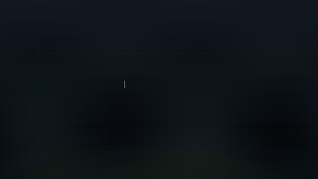

# longtake

**Launch films that never cut to the next slide.** A skill for coding agents: every beat has to survive into the next one, the camera is operated rather than keyframed, and an oracle measures whether the cut carries before a human watches it. One HTML composition per film, rendered with real shutter blur, scored from its own events.

MIT. Source of every film included. Commercial use included.



▶ [`cases/hello-12s`](cases/hello-12s/hello.mp4) — a 12 s film where one line is the whole film: caret, rule, shelf, baseline, underline. `carry 1.00`, verdict PASS, sound and comp both in the repo.

```
prompt → 3 concepts → beat sheet with carries → one comp → draft → judge → cut
```

---

## The problem

Agents make motion videos that read as a stack of slides. Each shot can be fine; the film still dies, because a shot **replaces** the last one. Title card, fade, UI shot, fade, feature card, fade, logo. Rhythm alone does not fix it — a uniformly paced slideshow is still a slideshow.

## What longtake does instead

It designs the **seam**. At every boundary something on screen survives and visibly becomes the next beat:

- a caret **stretches into** a rule, the rule **thickens into** a shelf, then **rises into** the baseline of a sentence, then **becomes** the underline of the wordmark (`cases/hello-12s`);
- a chip **morphs into** a card, the card **grows into** a page;
- a camera **pushes through** a card until its inside *is* the next scene (`LT.dive`);
- the cast **folds into** the lockup (`LT.fold`, `LT.stamp`).

And one camera holds it together. It never cuts: it follows the subject a beat ahead, whips to where the next thing will land, floats like a hand, shakes when something hits, and then holds dead still — because the rests are what make the moves land.

## Continuity is measured, not hoped for

`tools/probe.py` samples every frame of the composition, reads each registered layer's box, and at every boundary asks what survived and whether it actually moved. A declared carry whose pixels did not change is **bare**, whatever the beat sheet says. `tools/judge.py` turns that into a verdict.

Real numbers from this repo's own case:

| cut | cadence | rest | continuity | verdict |
| --- | --- | --- | --- | --- |
| hello-12s, v1 — rule never thickened (a composition bug), two beats bare | CV 0.65 | 70 % | **0.43**, bare at 1.70 / 2.60 / 4.40 / 9.20 | **FAIL** |
| hello-12s, v2 — one chain, each boundary mid-move | CV 0.81 | 65 % | **1.00**, nothing bare | **PASS** |

The same oracle fails equal shot lengths, no stillness, clipped audio, fast moves without shutter blur, and a subject that leaves the frame.

## What makes it look finished

- **The look ships with the comp.** `tools/look.py` writes eight colour tokens and three faces (subset, inlined) beside the composition; comp code never hardcodes a palette.
- **Measured moves, not hand-rolled eases.** 53 moves in `lib/anim.js` — springs, entrances, carries, contact, sims, camera, fluid grounds — each a pure function of time with a documented `t80`.
- **Real motion blur.** Every moving frame is several captures across an open 180° shutter, averaged in linear light; a declared cut is never dissolved.
- **Sound in one room.** Seven synthesised materials, one synthetic room, placed from the film's `__events()`, mastered so the AAC stays under −3 dBFS. Nothing recorded to clear.
- **Deterministic.** Clock to any time, get the same frame. 1080p30 drafts, 4K60 finals.

## Install

```
git clone https://github.com/you/longtake.git ~/.claude/skills/longtake   # Claude Code
git clone https://github.com/you/longtake.git ~/.agents/skills/longtake   # other agents that read skills
```

```
python3 -m venv .venv && . .venv/bin/activate
pip install -r requirements.txt
python -m playwright install chromium
```

Then ask: *"make a 15 s launch film for my app"*, *"this demo reads like a slideshow, fix it"*, *"rebuild this UI from screenshots and shoot a feature demo, no screen recording"*.

## Use

```
python3 tools/ref.py ref.mp4 --out ana/                    # 1 · the reference, in numbers
# 2 · three concepts that differ in their central idea — the user picks
# 3 · beat sheet: t · beat · what moves · what is still · what carries into the next beat
python3 tools/look.py apply bone cases/my-film/comp.html   # 4 · the look, as tokens
python3 tools/peek.py cases/my-film/comp.html --times 0.7,2.4,6.1 --out stills.png
python3 tools/probe.py cases/my-film/comp.html             #    what carries each boundary
python3 tools/sfx.py --comp cases/my-film/comp.html --out cases/my-film/sfx.wav
python3 tools/shoot.py cases/my-film/comp.html --out cases/my-film/draft.mp4 --sfx cases/my-film/sfx.wav
python3 tools/judge.py cases/my-film/draft.mp4 --comp cases/my-film/comp.html
python3 tools/shoot.py cases/my-film/comp.html --out cases/my-film/hello.mp4 --final --sfx cases/my-film/sfx.wav
```

| tool | does |
| --- | --- |
| `tools/ref.py` | reference → energy map, cuts, stillness, motion line, contact sheet |
| `tools/probe.py` | composition → what is on screen, per boundary; carry score, curves, framing |
| `tools/judge.py` | film → PASS/FAIL on cadence, rest, burst, audio, continuity, curves, framing |
| `tools/shoot.py` | composition → mp4 with shutter blur, adaptive captures, parallel browsers, resume |
| `tools/peek.py` | contact sheet of chosen times |
| `tools/sfx.py` | events → one-room sound bed, synthesised |
| `tools/look.py` | presets, a look from a screenshot, apply as tokens + faces |
| `tools/capture.py` | real page → real-time frames with the action frame marked (for footage) |
| `tools/motion_test.js` | the library's numbers, asserted |

`templates/comp.html` is the skeleton. `lib/paint.js` is the only place a transform is written. `lib/ui.js` holds the UI-replica plane, language times and subtitles for feature demos.

## Files

| path | what |
| --- | --- |
| `SKILL.md` | the protocol and the hard rules each rejected cut taught |
| `lib/anim.js` · `lib/paint.js` · `lib/ui.js` | moves; the painter and the probe contract; the replica plane |
| `looks/looks.json` · `looks/fonts/` | four starting looks, OFL faces |
| `references/` | method, beats, library, camera, sound, reading a reference |
| `cases/hello-12s/` | case 1: comp, sound, film, beat sheet and numbers |
| `gallery/gallery.html` | one live demo per move family (`?demo=morph&play`) |

## License and lineage

MIT — use it commercially, ship it, change it.

longtake was written from scratch after studying the method popularised by [onetake](https://github.com/feitangyuan/onetake) (PolyForm Noncommercial). No file here is copied: the API, the contracts, the tools, the looks and the words are this repo's. If you want that project's own code and films, buy its licence; if you want a permissive take on the method, this is it.
